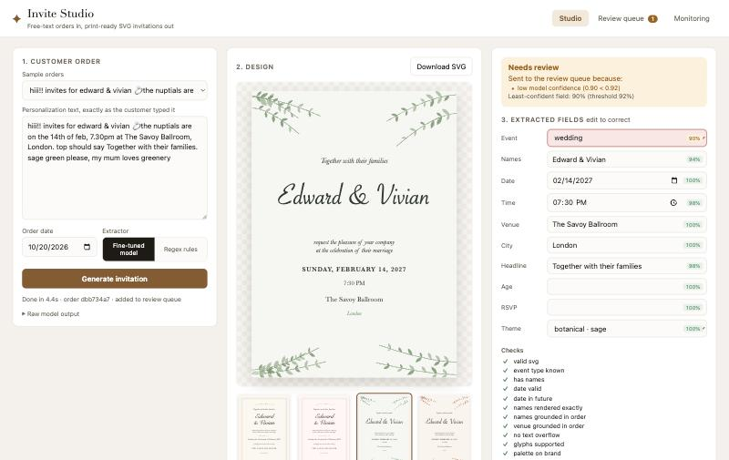

# Invite Studio

Turns the free-text personalization note on a print-on-demand order into a print-ready SVG
invitation, with no manual design work for orders the system is confident about and a review
queue for the rest.

> *"hiii!! invites for edward & vivian, the nuptials are on the 14th of feb, 7.30pm at The Savoy Ballroom,
> London. top should say Together with their families. sage green please"*
>
> becomes a validated, on-brand SVG in about two seconds, on a 16 GB laptop.



*The model read every field correctly, but "nuptials" never appeared as an event word in training, so its confidence on the event type (90%) fell below the 92% threshold and the order went to review instead of straight to print.*

## How it works

```
order text ──► fine-tuned extractor ──► structured fields + per-field confidence
                (Qwen2.5-1.5B, LoRA)                │
                                                    ▼
SVG template library ──► layout engine ──► SVG ──► checks ──► auto-approve
 (slots, boxes, palettes)  (real font metrics,              └─► review queue ──► corrections ──► retraining
                            procedural art)
```

**Hybrid design.** The model does the part that needs language understanding: reading messy
orders (missing years, "half past 7", "sage green please", "my son's party, he's turning 5") into
a fixed schema. Everything that has a right answer is deterministic: fitting text into boxes,
palettes, fonts, and decorative art. Generating whole SVG files token by token on a 1.5B model
would be slower, harder to validate, and free to go off-brand; generating ~80 tokens of JSON is fast
and every field can be checked.

### 1. Template library (`templates/*.svg`, `scripts/build_templates.py`)
Four templates (classic, botanical, modern, party), each a plain SVG file. Personalization slots are
`<text>` elements annotated with their box, font, size range, max lines, alignment, and color role;
the root carries the brand rules (allowed palettes and fonts). `audit_library()` turns the library
into a machine-readable schema (`GET /api/library`). Eight theme = template + palette combinations.

### 2. Layout engine (`invite_studio/layout.py`)
- Measures text with the real font files (fontTools advance widths), finds the largest font size in
  the slot's range that fits its box, then rebalances line breaks so there are no orphan words
  ("Maximilian-Alexander" and "Bo" both look designed).
- Formats dates and times in each template's voice ("Saturday, the fourteenth of June" vs `SAT 14.06.2027`).
- Grows procedural art per order: leaf sprigs and confetti seeded by the names, so every card is
  unique but reproducible.

### 3. Extractor (`invite_studio/model.py`, `scripts/train.sh`)
Qwen2.5-1.5B-Instruct (4-bit) with a LoRA adapter trained with MLX on Apple silicon.
Per-field confidence = the lowest token probability inside that field's value.

### 4. Checks and routing (`invite_studio/checks.py`, `invite_studio/pipeline.py`)
Valid SVG, required fields, real future date, every name rendered verbatim, names and venue
grounded in the customer's own text (catches hallucinations), no overflow, every glyph supported by
the font, palette and fonts on brand. An order ships automatically only if all checks pass **and**
every field's confidence clears the threshold; otherwise it goes to the review queue with the reasons.

### 5. Feedback loop (`server.py`, `scripts/retrain.py`)
Reviewers fix fields in the UI; each fix is logged to `data/corrections.jsonl`. `retrain.py`
upsamples corrections into the training set and trains a new adapter. The Monitoring tab tracks the
auto-approve rate, the confidence distribution, why orders went to review, and which fields humans
correct most.

## Data
`invite_studio/datagen.py` generates synthetic orders with their correct fields: 54 first names
(including accents, hyphens, two-word names), 5 event types, 12 date formats (some without a year,
resolved against the order date), 9 time formats, color hints instead of theme names, and chatter.
Wording styles are split: 6 styles for training, 3 **held-out** styles (formal email, `key=value`,
chatty story) used only for testing, so the test measures generalization to new wordings.

## Results

Test sets: 100 orders in the training wording styles ("seen") and 200 in three wording styles the
model never saw ("held-out"). The base model was scored on the first 100 of each. Confidence threshold
0.92, chosen on the seen set as the highest auto-approve rate with at least 99% accuracy among approved orders.

| Extractor | Test set | Full order exact | Names | Date | Theme | Auto-approved | Accuracy of auto-approved | Errors sent to review |
|---|---|---|---|---|---|---|---|---|
| Regex rules | seen | 12.0% | 45.0% | 100% | 99.0% | 74.0% | 12.2% | 26.1% |
| Regex rules | held-out | 0.0% | 56.5% | 100% | 98.5% | 79.5% | 0.0% | 20.5% |
| Qwen2.5-1.5B, 2-shot prompt | seen | 17.0% | 97.0% | 76.0% | 33.0% | 2.0% | 100% | 100% |
| Qwen2.5-1.5B, 2-shot prompt | held-out | 10.0% | 95.0% | 79.0% | 31.0% | 1.0% | 100% | 100% |
| **Qwen2.5-1.5B + LoRA** | seen | **97.0%** | 100% | 100% | 100% | 82.0% | **100%** | **100%** |
| **Qwen2.5-1.5B + LoRA** | held-out | **96.0%** | 100% | 99.0% | 99.5% | 68.0% | **100%** | **100%** |

What this shows:
- **Rules plus checks are not enough.** The regex parser's wrong orders still pass most checks (a wrong
  name that appears in the text is still "grounded"), so 80% of them would ship. Without a confidence
  signal there is no safe way to automate.
- **Prompting the base model is not enough.** It gets names right but misses the house rules (theme
  defaults, year inference), and its low confidence correctly sends almost everything to review.
- **Fine-tuning makes automation safe.** 96% of orders in unseen wordings are fully correct; every one
  of the 8 errors was routed to review; and 68% of orders ship with zero manual work. The remaining errors are
  the hard cases: dates without a year that fall close to the order date, and orders with no venue,
  where the model filled the slot with a nearby phrase (the RSVP contact's name) or invented one. Low
  confidence and the grounding check caught all of them, and reviewer fixes for exactly these cases feed
  the next training run.

LoRA training: rank 8 on 16 layers (5.3M trainable parameters), 200 iterations at batch size 4, about
20 minutes on a MacBook Air M4 (16 GB). Validation loss fell from 0.537 to 0.002. Inference takes about 2 s per order.

## Run it
```bash
uv sync
uv run python scripts/build_templates.py      # template library
uv run python scripts/make_dataset.py         # synthetic data
scripts/train.sh                              # LoRA fine-tune (MLX, Apple silicon)
uv run python scripts/evaluate.py             # rules vs prompted base vs fine-tuned
uv run uvicorn server:app --port 8765         # UI at http://localhost:8765
```

## Limits and next steps
- Training data is synthetic; real orders would replace most of it through the corrections loop.
- Fonts are macOS system fonts; production would ship licensed font files with the templates.
- Next: learn the layout itself (slot sizes and positions) from a large template library, and
  score rendered output with an image model for visual quality.
